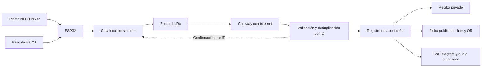

# Comunicación del centro

Funciona ahora: botón de tarjeta, cuentas, almacenamiento en navegador, respaldo JSON, consulta, gráfico simulado, QR público y voz local disponible. Preparado como ampliación: adaptador Python de Telegram con confirmación explícita de destinatario. Por conectar y probar: sensores, LoRa, NFC, sincronización y envío real de audio.

La ficha pública no contiene pagos. El respaldo completo es privado de la asociación. La selección de familia en la demo no es una barrera de seguridad; una versión con datos reales requiere autenticación y autorización del lado servidor.
